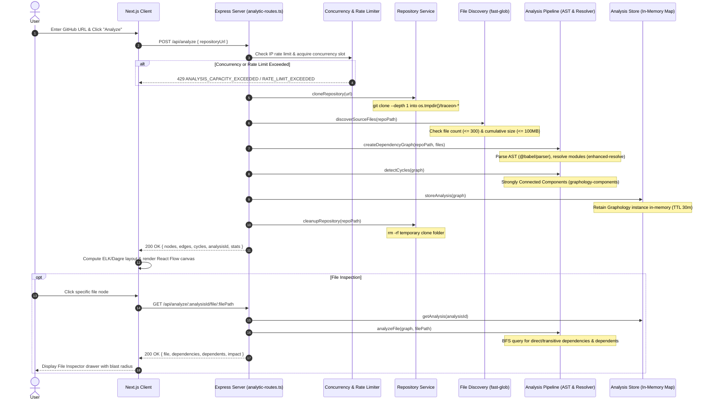

# Deptrace Architecture & Pipeline Specification

This document provides a technical overview of the Deptrace architecture, the end-to-end repository analysis pipeline, component responsibilities, graph computation mechanisms, and system safety boundaries.

---

## 1. System Topology & Request Flow

Deptrace is structured as a decoupled full-stack TypeScript system:

1. **Frontend Client (`/frontend`):** A client-rendered Next.js application that captures repository URLs, interacts with the backend REST API, computes visual layouts, and renders interactive graphs using `@xyflow/react`.
2. **Backend Engine (`/backend`):** A stateless Express API service that clones public repositories into ephemeral scratch directories, parses ASTs, resolves module paths, computes dependency metrics via Graphology, and maintains temporary in-memory analysis sessions.



---

## 2. End-to-End Analysis Pipeline

When a user requests an analysis through `POST /api/analyze`, the backend executes an orchestrated eight-step pipeline defined in `backend/src/routes/analytic-routes.ts`.

### Phase 1: Request Ingestion & URL Validation
- **File:** `backend/src/utils/github-url.ts`
- **Behavior:** The incoming string is parsed via standard URL parsing.
- **Rules Enforced:**
  - Protocol must strictly be `https:`.
  - Hostname must strictly be `github.com`.
  - Pathname must contain exactly two segments: `/<owner>/<repo>`.
  - Invalid formats reject immediately with HTTP `400 INVALID_REPOSITORY_URL`.

### Phase 2: Rate Limiting & Concurrency Controls
- **Files:** `backend/src/middleware/analysis-rate-limit.ts`, `backend/src/services/analysis-limiter.service.ts`
- **Behavior:**
  - **Rate Limiting:** Sliding-window in-memory rate limiter per IP address (configured by `RATE_LIMIT_WINDOW_MS`, default 60s; `MAX_ANALYSES_PER_WINDOW`, default 10). Rejections return HTTP `429 RATE_LIMIT_EXCEEDED`.
  - **Concurrency Limiting:** Enforces a hard cap on concurrent active analyses across the process (configured by `MAX_CONCURRENT_ANALYSES`, default 2). If all worker slots are occupied, requests return HTTP `429 ANALYSIS_CAPACITY_EXCEEDED`.

### Phase 3: Ephemeral Repository Shallow Clone
- **File:** `backend/src/services/repository.service.ts`
- **Behavior:**
  - Uses `child_process.execFile` (bypassing the shell) to run:
    ```bash
    git clone --depth 1 <url> <tempDirectory>/<repo>
    ```
  - Clones into a unique temporary folder (`os.tmpdir()/traceon-<random>/<repo>`).
  - Abort signals are wired to client disconnects (`req.on("aborted")` / `res.on("close")`) and overall timeouts (`ANALYSIS_TIMEOUT_MS`, default 5 min; `CLONE_TIMEOUT_MS`, default 60s).
  - Calculates directory size after cloning: if total clone size exceeds `MAX_CLONE_SIZE_BYTES` (default 500MB), the process throws `413 CLONE_SIZE_LIMIT_EXCEEDED` and removes the folder immediately.

### Phase 4: Source File Discovery & Safety Thresholds
- **File:** `backend/src/services/file-discovery.service.ts`
- **Behavior:**
  - Fast file globbing using `fast-glob` matching `**/*.{ts,tsx,js,jsx}`.
  - Automatically ignores standard build and vendor directories:
    `**/node_modules/**`, `**/.git/**`, `**/.next/**`, `**/dist/**`, `**/build/**`, `**/coverage/**`.
  - **File Count Threshold:** If matched files exceed `MAX_SOURCE_FILES` (default 300, capped at 300), throws `413 SOURCE_FILE_LIMIT_EXCEEDED`.
  - **Cumulative Size Threshold:** Sums file stats; if cumulative source size exceeds `MAX_SOURCE_SIZE_BYTES` (default 100MB), throws `413 SOURCE_SIZE_LIMIT_EXCEEDED`.

### Phase 5: AST Parsing & Import Extraction
- **File:** `backend/src/services/ast-parser.service.ts`
- **Behavior:**
  - Reads source code from disk and invokes `@babel/parser` with `sourceType: "unambiguous"` and plugins `typescript`, `jsx`, and `flow`.
  - Recursively traverses the AST to extract module specifiers from:
    1. Static imports: `import ... from "specifier"`
    2. Re-exports: `export { x } from "specifier"` and `export * from "specifier"`
    3. Dynamic imports: `import("specifier")`
    4. CommonJS calls: `require("specifier")`
  - Returns a deduplicated array of import specifiers.
  - **Fault Resilience:** Individual syntax errors or unsupported constructs in a single file increment `stats.failedFiles` without failing the entire repository analysis.

### Phase 6: Module Resolution & Alias Mapping
- **Files:** `backend/src/services/module-resolver.service.ts`, `backend/src/utils/import-classifier.ts`
- **Behavior:**
  - Factory function `createModuleResolver(repositoryPath)` initializes:
    - `enhanced-resolve` promise resolver with extensions: `.ts`, `.tsx`, `.js`, `.jsx`, `.mts`, `.cts`, `.mjs`, `.cjs` and main files `["index"]`.
    - `tsconfig-paths` loader inspecting the cloned repository root for `tsconfig.json` path mappings (`compilerOptions.paths` and `baseUrl`).
  - **ESM-to-TypeScript Mapping:** If a module specifier ends with `.js`, `.jsx`, `.mjs`, or `.cjs`, the resolver strips the extension to allow resolving to the underlying `.ts` or `.tsx` file (standard TypeScript NodeNext/ESM behavior).
  - **Boundary Validation:** Any resolved path outside the repository root (e.g. attempting directory traversal with `../../`) is immediately dropped.
  - **Import Classification:** Imports are categorized into `relative` (`./`, `../`), `builtin` (Node.js core modules), or `package` (external npm packages). Only internal repository files are linked as edges in the graph.
  - **Memoization:** Resolutions are cached in a per-analysis `Map` keyed by `${importerFile}\0${importSpecifier}`.

### Phase 7: Graph Construction & Cycle Detection
- **Files:** `backend/src/services/dependency-analyzer.service.ts`, `backend/src/services/cycle-detection.service.ts`
- **Behavior:**
  - Instantiates a `graphology` directed graph (`Graph({ type: "directed" })`).
  - Adds all discovered internal files as nodes.
  - Iterates through extracted imports, resolves internal target files, and inserts directed edges: `graph.addEdge(importerFile, resolvedFile)`.
  - Detects cycles using `stronglyConnectedComponents(graph)` from `graphology-components` (a path-based strongly connected components algorithm):
    - Groups nodes into SCC components.
    - Filters components where `component.length > 1` (multi-file cycle) or where a single node contains a self-loop edge (`graph.hasEdge(node, node)`).
    - Sorts cycles by length descending.

### Phase 8: Analysis Storage, Response Generation & Cleanup
- **Files:** `backend/src/services/analysis-store.service.ts`, `backend/src/services/graph-view-model.service.ts`, `backend/src/services/repository.service.ts`
- **Behavior:**
  - The live `Graphology` graph instance is placed in an in-memory `Map` keyed by a generated UUID (`analysisId`).
  - A timer is attached with `ANALYSIS_TTL_MS` (default 30 min) to automatically garbage-collect the graph.
  - If stored analyses exceed `MAX_STORED_ANALYSES` (default 100), the oldest entry is pruned.
  - Converts graph nodes and edges into a plain JSON view model (`{ nodes: [{ id, label }], edges: [{ id, source, target }] }`).
  - **Best-Effort Disk Cleanup:** In the route handler `finally` block (and in clone failure handlers), `cleanupRepository` executes `fs.rm` on the temporary folder. Cleanup is best-effort: filesystem errors (such as file-lock contention) or ungraceful process terminations can leave temporary directories behind, and no background orphan-cleanup mechanism exists.

---

## 3. File Inspection & Impact Traversal

When a user selects a file in the UI, the client queries `GET /api/analyze/:analysisId/file/:filePath`.

- **Files:** `backend/src/services/file-analysis.service.ts`, `backend/src/services/dependency-query.service.ts`, `backend/src/services/impact-analysis.service.ts`
- **Behavior:**
  - Retrieves the in-memory `Graph` instance for `analysisId`.
  - Performs graph queries:
    1. **Direct Dependencies:** `graph.outNeighbors(file)` — files imported by this module.
    2. **Direct Dependents:** `graph.inNeighbors(file)` — files importing this module.
    3. **Transitive Dependencies:** Breadth-First Search (BFS) following outbound edges (`outNeighbors`) with a `Set` to prevent infinite loops in cyclic subgraphs.
    4. **Transitive Dependents:** BFS following inbound edges (`inNeighbors`) with a `Set`.
    5. **Impact / Blast Radius:** Identical to transitive dependents — lists all downstream files that rely on the selected module directly or transitively.

---

## 4. Frontend Rendering & Visualization Engine

- **Files:** `frontend/src/app/page.tsx`, `frontend/src/components/GraphCanvas.tsx`, `frontend/src/graph/layout/elkLayout.ts`, `frontend/src/lib/graph-adapter.ts`

### Canvas & State Management
- Built on top of `@xyflow/react` (React Flow) inside a `ReactFlowProvider`.
- Custom node types:
  - `FileNode`: Renders individual source files with icon indicators, file path label, and visual cues for cycles, impact, or isolation.
  - `GraphGroupNode`: Renders clustered directory cards showing child file counts and directory paths.

### Dual Layout Strategy
1. **ELK Layered Layout (`elkjs`):**
   - Partitions the repository graph into weakly connected components.
   - Connected components are laid out with ELK's hierarchical layered algorithm (`layered`, direction `DOWN`, spacing rules).
   - Component boxes are placed side-by-side using a bin-packing row layout.
   - Disconnected / isolated files are grouped into a dedicated grid layout at the bottom to avoid distorting connected dependency hierarchies.
2. **Dagre Layout (`@dagrejs/dagre`):**
   - Invoked dynamically when users isolate a cycle, inspect directory subtrees, or focus on a selected node and its immediate neighborhood.

### Visual Scalability Abstraction
- When a repository exceeds 60 source files (`DIRECTORY_OVERVIEW_THRESHOLD`), the canvas automatically boots into **Directory Mode**, grouping nodes by their top two directory segments (`getDirectoryGroup`).
- Users can toggle between Directory Mode and File Mode at any time.

---

## 5. Security & Safety Boundaries

Public repositories are treated as **untrusted input**. The following controls are implemented to protect the host environment:

| Threat Vector | Implemented Mitigation | Relevant Code |
| :--- | :--- | :--- |
| **Command Injection** | Git operations use `execFile` with argument arrays instead of shell execution (`exec`). URL characters cannot inject shell commands. | `backend/src/services/repository.service.ts` |
| **Path Traversal** | Module resolution checks whether resolved paths escape the repository root (`relativePath.startsWith("..") \|\| isAbsolute`). Escaping paths are dropped. | `backend/src/services/module-resolver.service.ts` |
| **Disk Exhaustion (Zip Bombs / Huge Repos)** | Repositories are cloned with `--depth 1`. Total directory size is measured immediately after clone; exceeding `MAX_CLONE_SIZE_BYTES` (500MB) immediately aborts and cleans up. | `backend/src/services/repository.service.ts` |
| **Memory Exhaustion (Graph Size)** | Hard limit on source files (`MAX_SOURCE_FILES`, hard-capped at 300) and cumulative source bytes (`MAX_SOURCE_SIZE_BYTES`, 100MB). | `backend/src/services/file-discovery.service.ts`, `runtime-config.ts` |
| **Resource Starvation / DoS** | Concurrency limiter (`MAX_CONCURRENT_ANALYSES`, default 2) and sliding IP rate limiter (`MAX_ANALYSES_PER_WINDOW`, default 10 per 60s). | `backend/src/services/analysis-limiter.service.ts`, `analysis-rate-limit.ts` |
| **Hung Processes** | Clone timeout (`CLONE_TIMEOUT_MS`, default 60s) and overall request timeout (`ANALYSIS_TIMEOUT_MS`, default 5 min) enforce hard cancellation. | `backend/src/routes/analytic-routes.ts`, `repository.service.ts` |
| **Client Disconnect Leakage** | `req.once("aborted")` and `res.once("close")` trigger an `AbortController`, terminating ongoing git operations and triggering directory cleanup. | `backend/src/routes/analytic-routes.ts` |
| **Storage Leakage** | Best-effort clone deletion in `finally` blocks and clone error handlers via `cleanupRepository`. Analysis graph objects expire in memory after 30 minutes via `ANALYSIS_TTL_MS`. | `backend/src/services/analysis-store.service.ts`, `repository.service.ts` |

> [!NOTE]
> Deptrace runs in the security context of the Node.js process. In production, the backend should be deployed in an isolated container or sandbox with restricted network egress, limited disk quotas, and a non-root user.

---

## 6. Component Responsibility Matrix

| Component / File | Layer | Primary Responsibility |
| :--- | :--- | :--- |
| `backend/src/server.ts` | Server | Express app configuration, CORS, JSON body limits, global error handling, graceful shutdown. |
| `backend/src/routes/analytic-routes.ts` | Route | HTTP orchestration for `/api/analyze` and `/api/analyze/:analysisId/file/:filePath`. |
| `backend/src/config/runtime-config.ts` | Config | Runtime configuration validation, positive integer checks, fallback defaults. |
| `backend/src/services/repository.service.ts` | Service | Git shallow clone execution, directory size tracking, and directory cleanup. |
| `backend/src/services/file-discovery.service.ts` | Service | Fast-glob source discovery, directory ignoring, file count & size limit enforcement. |
| `backend/src/services/ast-parser.service.ts` | Service | Babel parsing, AST traversal, import/export specifier extraction. |
| `backend/src/services/module-resolver.service.ts`| Service | Module resolution via `enhanced-resolve`, `tsconfig-paths`, and ESM extension normalization. |
| `backend/src/services/dependency-analyzer.service.ts`| Service | Assembling Graphology graph and computing analysis statistics. |
| `backend/src/services/cycle-detection.service.ts`| Service | `stronglyConnectedComponents` path-based SCC algorithm to detect self-loops and circular import chains. |
| `backend/src/services/analysis-store.service.ts` | Service | In-memory session store with TTL expiration and LRU size pruning. |
| `backend/src/services/dependency-query.service.ts`| Service | Direct & transitive BFS graph queries for dependencies and dependents. |
| `backend/src/services/impact-analysis.service.ts`| Service | Transitive blast-radius impact analysis for changed files. |
| `frontend/src/app/page.tsx` | View | Main Next.js client component managing analysis state and error toasts. |
| `frontend/src/components/GraphCanvas.tsx` | View | React Flow canvas component managing view modes, cycles, search, and interactions. |
| `frontend/src/components/FileInspector.tsx` | View | Drawer component displaying dependency metrics, lists, and blast-radius impact. |
| `frontend/src/graph/layout/elkLayout.ts` | Layout | ELK layout engine partitioning components and computing node coordinates. |
| `frontend/src/lib/api.ts` | Client API | Fetch wrappers for `/api/analyze` and file inspection endpoints. |
